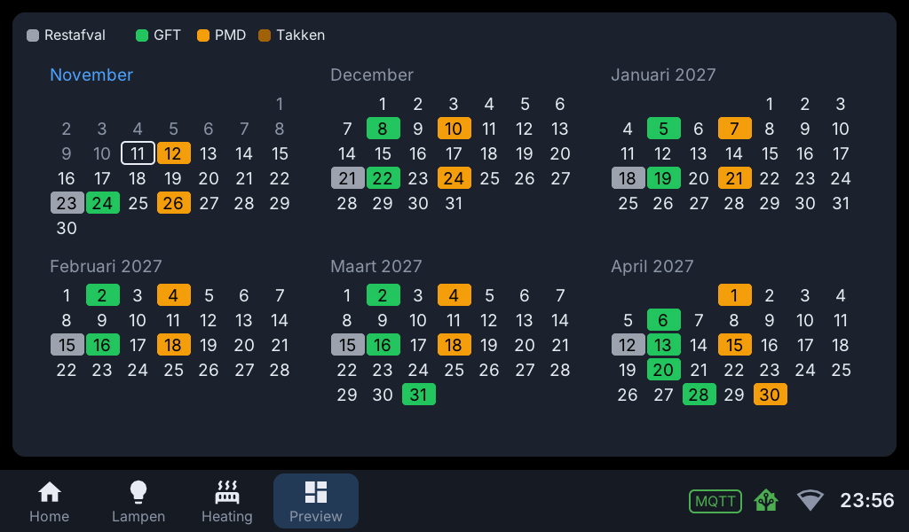

# Afval app (waste calendar)

Shows when each kind of waste is collected, for the Dutch waste collectors
that the Home Assistant integration
[Afvalbeheer](https://github.com/pippyn/Home-Assistant-Sensor-Afvalbeheer)
supports.

**The card** shows the next collection ("GFT + PMD" when two kinds are
collected on the same day) and "Morgen", "Vandaag" or the date. A taller card
also shows the days after it.

**The full screen** (tap the card) shows the next six months, starting with
this one, each collection day in the colour of its kind of waste, today with an
outline, and the colours explained above the calendar.

## What you need

1. The **Afvalbeheer** integration in Home Assistant, which makes a sensor for
   each kind of waste (for example `sensor.meerlanden_gft`) with the attributes
   `Days_until` and `Sort_date`, and a calendar (for example
   `calendar.afvalbeheer_meerlanden`).
2. ReToon 1.36 or later, connected to Home Assistant. The app reads the
   sensors, and the calendar with `retoon.call`, over that connection, so it
   needs no address and no token of its own.

## Settings

In the Toon's web interface under **Apps**:

| Setting | What to enter |
|---|---|
| Waste sensors | One row for each kind of waste (up to 6): the sensor, and optionally a name, icon and colour |
| Waste calendar | The calendar of the integration (optional; without it the full screen only shows the next date of each kind) |

You do not have to choose colours or icons: they follow the name of the kind
of waste (a word in it is enough): gft/groen green, pmd/plastic orange,
rest/grijs grey, papier/karton blue, tak/tuin brown, glas teal, textiel purple,
kca red. To choose your own, type a colour name (green, blue, orange, red, grey,
brown, purple, yellow, or the Dutch groen, blauw, oranje, rood, grijs, bruin,
paars, geel) or `#rrggbb`, and an icon such as `mdi:leaf`.

## How the months are filled

A sensor only knows the next collection. The following months come from the
calendar: the app calls `calendar.get_events` (listed in the manifest's
`services`, the only service it calls) for the current month and the six after
it. It reads the calendar when it starts, after saving the settings, and every
6 hours. An event is matched to a kind of waste by its title; an event without
a title is ignored.

Dates further ahead appear as soon as the waste collector publishes them: with
Meerlanden the calendar currently runs about twelve months ahead, so six months
are always filled.
