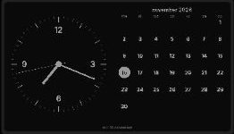

# Clock Studio Duo

Two independently configurable clock apps by Nomzi Design: `clock-studio` for a normal page and `clock-studio-dim` for a dimmed home page.

## Installation

After this contribution is merged and published, install either or both apps under **Apps → Available** in the ReToon web interface. Add an **App** card to a page and choose the installed clock. For the dim variant, place it on the page configured as the dimmed home page. ReToon controls brightness and page switching; these apps do not change either.

| App | Minimum version | Default face |
| --- | --- | --- |
| Clock Studio | ReToon 1.40 / API 9 | World map |
| Clock Studio Gedimd | ReToon 1.40 / API 9 | Minimal analog |

Both clocks work without Home Assistant. The optional calendar requires an existing Home Assistant connection and permission for `calendar.get_events`. It reads events and does not modify them. Time comes from the Toon's local system clock, including on the world-map face: this is not a multi-time-zone clock.

## Settings

The **Wijzerplaat** dropdown (`layout`): `world`, `minimal`, `classic`, `square-small`, `square`, `digital`, `stacked`, `calendar`, or `auto`.

The **Kleurstijl** dropdown (`theme`): `blauw`, `paars`, `wit`, `rood`, or `groen`. Native colour pickers override the theme; choose Standard to use the theme/default colours. Date and seconds can be switched independently. Digital clocks use seven-segment digits; the seconds setting blinks the colon in the horizontal digital face.

The calendar face combines an analog clock with the current month. An optional `calendar.…` entity adds event dots and, when space permits, upcoming appointments. Small cards fall back to simpler faces; tapping the card opens the larger view.

Each app has its own settings. Download [Instellen.html](Instellen.html) and open it locally for advanced colours, hand styles, scale, location marker and calendar preferences. Paste the generated JSON into that app's **Uitgebreid profiel** field. This profile overrides the simple settings; clear it, or remove its layout or colour keys, to let the corresponding dropdowns/pickers take effect again. For a fully black dim card use no profile or set its background to `#000000`.

The world-map example location is Amsterdam. Change `place`, `latitude`, and `longitude` in the advanced profile to set your own label and marker. No location lookup or external map request is made.

## Release 1.4.6

- Both apps require API 9 (ReToon 1.40+).
- Analog hands and text are updated in place with `el.set`; the static dial and world map no longer rebuild on clock ticks.
- The digital display now uses seven retained boxes per digit, plus two colon dots; only changed segments are recoloured.
- Calendar layout redraws only when the date or event dots change, or settings/page layout require it. Upcoming appointment text updates in place.
- Clock faces and themes use native dropdowns; individual colours use native colour pickers.

Validation: manifest and JavaScript syntax checks, and simulated retained-element updates. A physical test on both Toon models, including settings changes, is still needed.

## Release 1.4.5

Initial catalogue submission based on the locally installed Duo 1.4.4. Replaces the developer's location defaults with an Amsterdam example and includes public installation instructions. No personal installer, network address, tokens or agenda data are distributed.

The installed 1.4.4 calendar view was observed on a Toon 2 running ReToon 1.48. The 1.4.5 package has static validation and simulated drawing checks; a full device test of this exact version, other faces, optional calendar connection and Toon 1 is still required. During screenshot preparation, saving a different face did not change the running calendar view. This needs verification before merging; original settings were restored.

## Licence and attribution

GPL-2.0-or-later, following this repository's default licence. World-map coordinates are derived from Natural Earth (public domain): https://www.naturalearthdata.com/about/terms-of-use/.

## Screenshots

Captured from the live ReToon web interface with installed Clock Studio 1.4.4. The calendar image is a small browser preview, not a native-resolution export.

