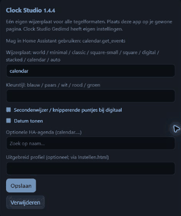

# Clock Studio

One configurable clock app by Nomzi Design for normal and dimmed ReToon pages. Each card has its own appearance and the full screen uses the settings of the tapped card.

## Installation

Requires **ReToon 1.50 or newer (API 10)**. Install **Clock Studio** once under Apps → Available in the ReToon web interface. Add an App card to a page and select Clock Studio. Edit that card to choose its own face, theme, colours, seconds, date and other options.

For a dimmed home page, add another card using the very same Clock Studio app. For example, select the minimal analog face, white theme, black background (`#000000`) and corner radius 0. ReToon controls brightness and page switching; the clock app does not change either.

### Upgrading from Clock Studio Duo 1.4.6

The separate `clock-studio-dim` app is no longer needed. Before removing it from your Toon, note its existing settings/profile. Add or edit a Clock Studio card on your dimmed page and copy those settings to its card editor. Do the same for your normal clock card if it previously used app-wide settings. Both cards can now be configured independently. Verify the replacement works before removing the old dim app. The existing global calendar entity remains under Apps.

## Settings

**Shared under Apps:** optional Home Assistant calendar entity, look-ahead window (1–60 days) and whether appointment titles are shown. The clock works without Home Assistant; the optional integration only reads events via `calendar.get_events`.

**Per card in the card editor:** face (`layout`), colour theme, individual colours, seconds, date, title, 12/24-hour time, scale, corner radius, hand controls, map location and optional advanced profile. Choose Standard for a colour to use the default/theme instead.

- Faces: `world`, `minimal`, `classic`, `square-small`, `square`, `digital`, `stacked`, `calendar`, and `auto`.
- Themes: `blauw`, `paars`, `wit`, `rood`, and `groen`.
- The digital clocks use classic chamfered seven-segment LED digits. The seconds setting blinks the colon in the horizontal digital face.
- The calendar combines an analog clock with the current month. An optional calendar entity adds event dots and, when space permits, upcoming appointments.

Small cards fall back to simpler faces; tapping opens a larger view with the same card's settings. The world-map face shows the local system time, not multiple time zones.

### Advanced customization

All hand and map settings are available directly in the card editor, including hand thickness, minute ticks, and the map's place name and coordinates. The default face is now a lighter minimal analog clock; the world map is still available as a choice. The map's example location is Amsterdam. No location lookup or external map request is made.

If you prefer a reusable JSON profile, [Instellen.html](Instellen.html) still works locally. Paste its output into **Optioneel JSON-profiel** in the card editor and explicitly enable **JSON-profiel gebruiken**. Only then do the keys in the profile override the native fields. Disable the checkbox to return to native settings. Existing 1.4.7 profiles remain saved but must be explicitly enabled after updating, or copied into the native fields. Calendar preferences remain under Apps.

## Release 1.4.8

- Added native per-card hand and world-map settings, and made JSON-profile overrides explicit and opt-in.
- Changed the default face to `minimal` for faster page switches, especially on Toon 1.
- Replaced rounded diagonal cap strokes with fine, symmetric chamfered LED shapes using one retained line per segment (28 for four digits, plus two colon dots). Only changed segments are recoloured.
- Removed the unreachable API compatibility check; API 10 remains required and is the latest documented level.
- Validation: repository manifest check and JavaScript syntax check pass; simulated 216 face/size/theme/seconds combinations, independent native and profile settings, full screen, retained minute updates, and horizontal/vertical segment geometry. Physical Toon 1/2 verification is still required.

## Release 1.4.7

- Consolidated Clock Studio Duo into a single app using API 10's `cardSettings`. Appearance and full-screen settings are independent for every card; Home Assistant calendar settings are shared.
- Restored the classic chamfered LED digits with three retained elements per logical segment (84 for the four digits, plus two colon dots). Only changed segments are recoloured. Clock hands, text and the static world map continue to update without routine full redraws.
- Validation: JavaScript syntax and simulated drawing/tick tests covering 108 combinations of face, size, theme and seconds setting; additional tests cover simultaneous independent cards/full screen, editing one card, stale handles, month rollover and mocked calendar refreshes. Physical verification of this release on ReToon 1.50 / Toon 1 and Toon 2 is still required.

## Licence and attribution

GPL-2.0-or-later, following this repository's default licence. World-map coordinates are derived from Natural Earth (public domain): https://www.naturalearthdata.com/about/terms-of-use/.

## Screenshots

Earlier Clock Studio 1.4.4 examples from the live ReToon web interface (the settings editor shown predates API 10).

